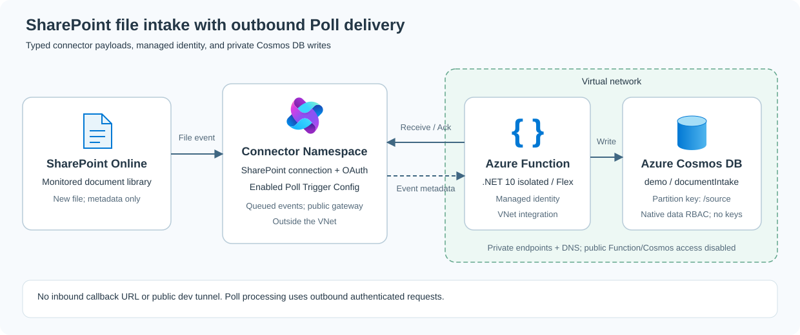

# Supplier Document Intake with SharePoint and Private Cosmos DB

> A procurement team collects supplier documents in SharePoint. Each upload is automatically registered in private Cosmos DB with status `Received`, providing a reliable intake record for downstream review. The Function pulls events through Connector Namespace Poll delivery; no public callback is needed.

This .NET 10 sample uses the published [Azure Functions Connector extension](https://www.nuget.org/packages/Microsoft.Azure.Functions.Worker.Extensions.Connector), [Azure Connectors .NET SDK](https://github.com/Azure/Connectors-NET-SDK), and managed identity. Packages restore through the `upstream_public` feed in `NuGet.config`; no extension checkout is required.



## Prerequisites

- Azure Developer CLI (`azd`), Azure CLI (`az`) with the `connector-namespace` extension, .NET 10 SDK, and PowerShell 7.
- An Azure subscription with provisioning/role-assignment permissions and access to a SharePoint document library.
- For local execution: Functions Core Tools, Azurite, developer access policies/data roles, and VNet/private DNS connectivity to Cosmos DB.

## Deploy and test in Azure

Run from this repository root:

```powershell
azd auth login
az login
azd env new sp-poll-cosmos
azd up
```

Follow the prompts for subscription, location, SharePoint site, and the publishing workstation's public IPv4 address. The library defaults to `Documents`; set `SHAREPOINT_LIBRARY_NAME` or `SHAREPOINT_FOLDER_PATH` with `azd env set` to override it.

The workflow builds, provisions, publishes, creates local settings, then opens SharePoint consent **last**. Publication temporarily allows only your `/32` and restores disabled public Function access in `finally`. Cosmos stays private.

Upload [`sample-data\Supplier-Order-DEMO-001.txt`](sample-data/Supplier-Order-DEMO-001.txt) to the monitored library/folder. Use a new file name for each test. Inspect `demo/documentIntake` from a VNet-connected workstation with Cosmos data-reader permissions.

## Run automated tests

```powershell
dotnet test .\tests\SharePointCosmos.Tests\SharePointCosmos.Tests.csproj
```

## Run locally

`azd up` creates ignored `local.settings.json` and preserves an existing file. Local execution uses your developer identity; network access and data permissions are still required. **Stop the cloud Function** first to avoid competing consumers.

Start Azurite in a separate terminal:

```powershell
az login
azurite --silent --location "$env:LOCALAPPDATA\Azurite\sharepoint-cosmos"
```

Then run:

```powershell
dotnet build .\SharePointCosmos.csproj
func start --script-root .\out\bin\SharePointCosmos\debug --no-build --port 7079
```

Stop the local host before restarting the cloud Function. Regenerate settings when switching environments with `.\infra\scripts\postdeploy.ps1 -ForceLocalSettings`.

## How the workflow works

SharePoint file-created metadata is queued in Connector Namespace. The Function receives it outbound, uses the SDK's typed payload, writes through the Cosmos output binding, and acknowledges successful processing. Stable IDs prevent duplicate records on redelivery; document content is not downloaded.

### Optional tuning

The trigger uses Connector defaults: single-event input, up to 16 concurrent calls per listener, and a target pending-event threshold of 16. The demo sets `extensions.connector.maxPollingInterval` to five seconds to cap empty-queue Receive delays; SharePoint source detection has its own schedule. Override concurrency or scaling thresholds only when tuning a workload.

Batching is opt-in: set `IsBatched = true`, choose `MaxBatchSize` above its default of 1 (maximum 32), and change the input to `ConnectorEvent<T>[]`. Batches run one at a time per listener; `MaxConcurrentCalls` does not apply.

## Upgrade or clean up

Rerun `azd up` after code changes. Before teardown, disable the demo trigger and confirm the resource group contains only demo resources, then run `azd down`. The always-ready instance and private endpoints incur ongoing cost.

## How auth works (no secrets)

Managed identity authorizes connector, storage, and Cosmos access; the SharePoint connection uses user OAuth consent. Function and Cosmos public inbound access are disabled outside publication. Host/deployment storage remains publicly reachable with identity-based access.

## Deployment scripts

`azure.yaml` orchestrates Bicep and the helpers in `infra\scripts`: failure-safe private publication using the Flex publish API, local-settings generation, and final SharePoint consent. Publication uses your Azure CLI identity and verifies the returned deployment ID without probing the private Function's public host endpoint. Poll registration and cloud settings remain in Bicep.

## Troubleshooting

Check connection consent, access policies, trigger state, and Application Insights exceptions. For Cosmos errors, check private DNS/connectivity and native data roles. A "Prepared" log alone does not prove the write completed.

On networks with destination-specific outbound proxies, a public IP lookup can differ from the address SCM sees. Use the `x-ms-forbidden-ip` response header from the Function's SCM endpoint as the publishing IPv4; do not broaden the temporary `/32` rule.

## Resources

- [Connector Namespace overview](https://learn.microsoft.com/azure/connector-namespace/connector-namespace-overview).
- [Cosmos output binding](https://learn.microsoft.com/azure/azure-functions/functions-bindings-cosmosdb-v2-output).
